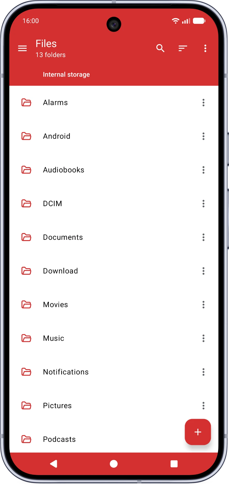
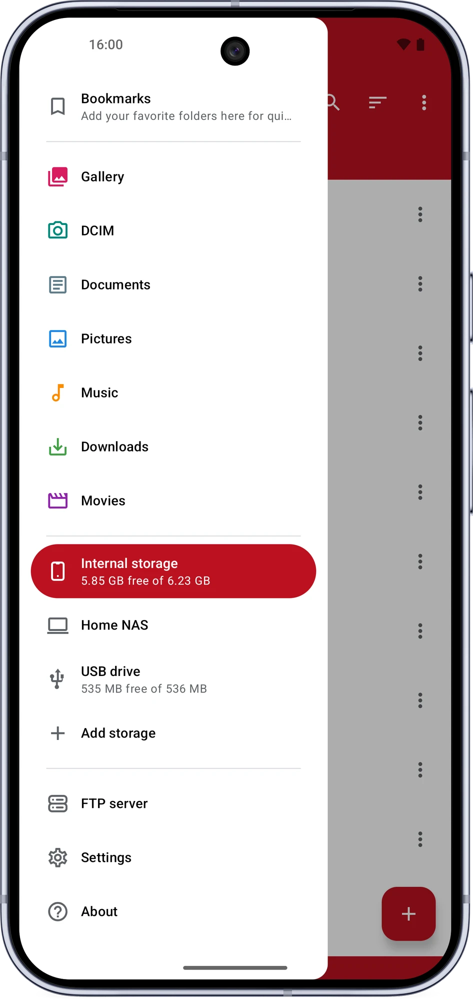
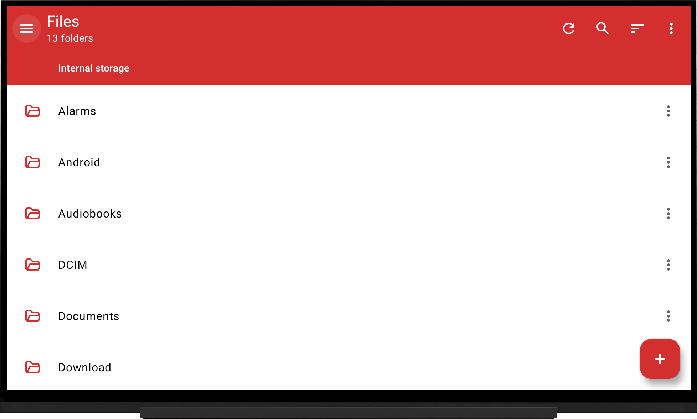

# VFiles

[English](README.md) · **Français**

[](https://github.com/Victor-root/VFiles/releases)
[](https://github.com/Victor-root/VFiles/commits/main)
[](https://github.com/Victor-root/VFiles/releases/latest)
[](https://github.com/Victor-root/VFiles/releases/latest)

Un fork personnel et amélioré de **[Material Files](https://github.com/zhanghai/MaterialFiles)** de Hai Zhang, un gestionnaire de fichiers Material Design open source pour Android.

Le dépôt d'origine reste la référence ; les sections ci-dessous décrivent **uniquement ce que ce fork ajoute ou modifie**. Pour ce qu'est fondamentalement l'application, voir [À propos de l'application d'origine](#à-propos-de-lapplication-dorigine).

## 📸 Captures d'écran

<p align="center"><strong>📱 Mobile</strong></p>
<p align="center">
<picture>
  <source media="(prefers-color-scheme: dark)" srcset="docs/screenshots/mobile-dark.webp" />
  
</picture>
&nbsp;&nbsp;
<picture>
  <source media="(prefers-color-scheme: dark)" srcset="docs/screenshots/sidebar-dark.webp" />
  
</picture>
</p>

<p align="center"><strong>📺 Android TV</strong></p>
<p align="center">
<picture>
  <source media="(prefers-color-scheme: dark)" srcset="docs/screenshots/tv-dark.png" />
  
</picture>
</p>

## 📥 Téléchargement et mises à jour

<p align="center">
  <a href="https://victor-root.github.io/Omnify/add?url=https%3A%2F%2Fgithub.com%2FVictor-root%2FVFiles"></a>&nbsp;&nbsp;&nbsp;&nbsp;&nbsp;<a href="https://github.com/Victor-root/VFiles/releases"></a>
</p>

## ✨ Ce que ce fork change

### 🧩 Reconstruit en Jetpack Compose
- Toute l'interface est reconstruite en Jetpack Compose et Material 3 : fonds neutres, accent rouge par défaut, choix des réglages dans des panneaux en bas d'écran et menus d'actions regroupés.
- Démarrage plus rapide et défilement plus fluide des gros dossiers, avec des écrans qui s'ouvrent dans l'app.
- Nécessite **Android 8.0 ou plus récent**.

### 🖼️ Galerie, musique, vidéo et PDF intégrés
- **Galerie** dans la barre latérale : photos et vidéos par jour ou par mois, albums par dossier, et une visionneuse plein écran.
- **Lecteur de musique** : titres, albums et artistes, lecture en arrière-plan contrôlable depuis la notification. Il s'ajoute à la barre latérale depuis Réglages → Dossiers standard.
- **Lecteur vidéo** et **lecteur PDF** (page par page ou ajusté à la largeur, zoom au pincement, aller à une page).

### 🔑 Support de Shizuku
- Avec [Shizuku](https://shizuku.rikka.app/) (ou Sui), Android/data et Android/obb sont accessibles sans root.
- Un simple **« Accorder avec Shizuku »** donne l'accès à tous les fichiers, même sur les TV dont les réglages ne le permettent pas.

### 📺 Support Android TV
- Navigation complète à la télécommande : la barre latérale, la barre d'outils et les listes sont accessibles et correctement surlignées.
- Un bouton Actualiser dans l'en-tête, la touche menu ouvre les menus, gauche ouvre la barre latérale, et les fenêtres de choix placent le focus sur le choix actuel.

### 🚀 Accueil au premier lancement
- Demande dès le départ les autorisations nécessaires (accès à tous les fichiers, notifications, installation d'applications), en tuiles sur TV.
- Là où seul adb peut donner l'accès à tous les fichiers, il affiche la commande exacte, ou le bouton Shizuku quand Shizuku est en marche.

### 💾 Stockage amovible (carte SD / USB)
- Les cartes SD et clés USB **apparaissent automatiquement dans la barre latérale** au branchement, sans passer par « Ajouter un support ».
- **Renommage** d'un volume et choix de son **icône** ; USB ou SD est détecté automatiquement.
- Les partitions d'un même disque sont regroupées sous un seul en-tête **« Clé USB » / « Carte SD »**.
- Raccourci **Éjecter**, et l'espace libre se met à jour en direct.

### 🎯 Applications par défaut et opérations sur les fichiers
- **Réglages → Applications par défaut** : choisissez quelle app ouvre les images, l'audio, les vidéos, les PDF et le texte, lecteurs de VFiles compris.
- Pendant les copies, déplacements et opérations d'archive, un bouton de la barre d'outils affiche la progression de chaque fichier en direct.

### 🔒 Confidentialité et performance
- **Firebase (Analytics + Crashlytics) entièrement supprimé.** Rien sur votre usage ou les plantages ne quitte l'appareil, et l'application démarre plus vite.
- Sauvegarde cloud et extraction de données désactivées.

### 🎨 Interface
- Les icônes des barres d'état et de navigation suivent ce qui est affiché derrière elles, barre latérale ouverte comprise.
- Barre d'application foncée en mode nuit, icônes dans les menus ⋮, et barre latérale Material You.
- Les noms longs passent à la ligne au lieu d'être coupés ; un ruban marque les dossiers en marque-page.
- **Bord à bord** optionnel (Réglages → Interface) : le contenu défile derrière les barres du système. Désactivé par défaut.

### 🐛 Autres corrections et finitions
- Un message clair quand un dossier ne peut pas être ouvert.
- **Chiffrement** optionnel pour les partages SMB, et une recherche des serveurs SMB du réseau local bien plus rapide.
- Les dossiers standard de la barre latérale se réordonnent, par glisser-déposer ou à la télécommande.
- Correction d'un plantage sur tablette en paysage ; Retour à la racine quitte l'app ; les titres longs de la barre d'outils défilent.
- Textes du fork traduits en **31 langues**.
- Identifiant `fr.vroot.vfiles`, pour s'installer à côté de la version Play/F-Droid de Material Files.

## ⬆️ Mettre VFiles à jour

- **Téléchargement direct** : installez la dernière APK de la page des [releases](https://github.com/Victor-root/VFiles/releases) par-dessus la vôtre. Elle est toujours signée avec la même clé, donc vos fichiers et réglages sont conservés.
- **[Omnify](https://github.com/Victor-root/Omnify)** : mon fork de client F-Droid, qui installe et met à jour les applications directement depuis leur dépôt GitHub.

La première fois, l'application qui ouvre l'APK demande l'autorisation d'installer des applications inconnues.

## 🗂️ Faire de VFiles le sélecteur de fichiers par défaut du système

VFiles expose **tous les back-ends qu'il gère** via le sélecteur de fichiers Android : le stockage local, les partages SMB, FTP, SFTP et WebDAV, et le contenu des archives apparaissent comme des dossiers dans la fenêtre « Ouvrir » ou « Enregistrer » de n'importe quelle app.

Android envoie `ACTION_OPEN_DOCUMENT`, `ACTION_CREATE_DOCUMENT`, `ACTION_OPEN_DOCUMENT_TREE` et `ACTION_GET_CONTENT` à **DocumentsUI** (`com.google.android.documentsui`, ou `com.android.documentsui` sur les ROM basées sur AOSP). Le désactiver fait de VFiles le sélecteur de toutes les apps. Sans root.

### Depuis l'app, avec Shizuku

Avec [Shizuku](https://shizuku.rikka.app/) en marche, activez **VFiles comme sélecteur de fichiers par défaut** dans les réglages. VFiles explique d'abord ce qui va se passer, et désactiver l'option remet le sélecteur comme avant. Si le sélecteur a été retiré avec `pm uninstall --user 0`, l'option apparaît activée, et la désactiver le ramène.

**Désactivez l'option avant de désinstaller VFiles.** Android ne réactive pas son sélecteur tout seul, donc plus aucune app ne pourrait choisir de fichiers. Pour réparer, réinstallez VFiles et désactivez l'option, ou lancez les commandes ci-dessous.

### Depuis un ordinateur, avec ADB

```sh
# Faire de VFiles le sélecteur par défaut (la deuxième ligne sert aux ROM basées
# sur AOSP, la troisième aux ROM avec un module overlay ; ignorer les erreurs)
adb shell pm disable-user --user 0 com.google.android.documentsui
adb shell pm disable-user --user 0 com.android.documentsui
adb shell pm disable-user --user 0 com.google.android.overlay.modules.documentsui

# Remettre le sélecteur du système
adb shell pm enable com.google.android.documentsui
adb shell pm enable com.android.documentsui
adb shell pm enable com.google.android.overlay.modules.documentsui
```

### Notes

- Le changement survit aux redémarrages et ne vaut que pour l'utilisateur actuel (en général l'utilisateur 0). Testé sur **LineageOS** et d'autres ROM basées sur AOSP.
- `ACTION_GET_CONTENT` et `ACTION_PICK` s'adressent aussi à des apps comme Drive ou une galerie, donc Android affiche un choix : choisissez VFiles puis **Toujours**. Android le retient par type de fichier, il peut donc redemander pour un autre type.
- **Versions récentes d'Android** (constaté sur Android 16) : les demandes d'images et de vidéos via `ACTION_GET_CONTENT`, et toutes les demandes `ACTION_PICK_IMAGES`, obtiennent le sélecteur de photos du système, qu'une app ne peut pas remplacer. Désactiver `com.google.android.photopicker` ramène l'ancien sélecteur là où il existe, dont l'entrée **Parcourir** ouvre VFiles.
- **Android TV :** DocumentsUI n'est pas installé, et un faux composant qui ne fait rien apparaît dans le choix. Choisissez VFiles puis **Toujours**, ou désactivez-le avec `adb shell pm disable-user --user 0 com.android.tv.frameworkpackagestubs`.
- Les autres rôles du gestionnaire de fichiers système passent aussi à VFiles : tuiles de stockage des Paramètres, ouverture des téléchargements, et demandes d'accès à un dossier des apps d'avant Android 10.
- **Les archives** s'ouvrent comme des dossiers pour choisir un fichier à l'intérieur, sauf si l'app demande l'archive elle-même. Les fichiers dans les archives sont en lecture seule.
- **FTP et WebDAV** ne savent que remplacer un fichier entier, donc les apps qui en écrivent une partie reçoivent une erreur. SMB et SFTP n'ont pas cette limite.

### 🔧 Pour les créateurs de ROM

Une variante de build optionnelle, `systemPicker`, signée avec la clé plateforme de la ROM, remplace purement et simplement DocumentsUI et renvoie les mêmes URI de stockage, si bien que même les apps qui les exigent fonctionnent. Voir [`docs/systempicker-integration.md`](docs/systempicker-integration.md) (en anglais). Cela n'affecte pas une installation normale.

---

## À propos de l'application d'origine ℹ️

Material Files est un gestionnaire de fichiers Material Design open source pour Android 6.0+ :

- Material Design soigné et navigation par fil d'Ariane.
- Support root ; voir, extraire et créer les archives courantes ; FTP, SFTP, SMB et WebDAV.
- Couleurs personnalisables et mode nuit (avec noir intégral optionnel).
- Compatible Linux (liens symboliques, permissions et contexte SELinux) via de vrais appels système plutôt qu'en analysant `ls`, bâti sur l'API de fichiers Java NIO2 avec `ViewModel` / `LiveData`.

## 💭 Pourquoi ce fork ?

Material Files est déjà une excellente application. Ceci n'est **pas** un concurrent ni une critique de l'original. Je l'ai forké pour avoir une version adaptée à **mon usage quotidien** : surtout des améliorations de cohérence de l'interface, des corrections de bugs, et un vrai support **Android TV**. Tout ce qui précède repose sur le travail de l'auteur d'origine, à qui revient tout le mérite de l'application.

## 🙏 Crédits et licence

- **Application d'origine et toutes ses fonctionnalités :** [Hai Zhang](https://github.com/zhanghai) et les contributeurs.
- **Ce fork :** [Victor-root](https://github.com/Victor-root).

Distribué sous **licence publique générale GNU v3.0**, la même que l'original. Voir [LICENSE](LICENSE).

```
Copyright (C) 2018 Hai Zhang
Copyright (C) 2024 Victor-root (fork modifications)

This program is free software: you can redistribute it and/or modify it
under the terms of the GNU General Public License as published by the Free
Software Foundation, either version 3 of the License, or (at your option)
any later version. It is distributed WITHOUT ANY WARRANTY; see the GNU
General Public License for more details.
```
