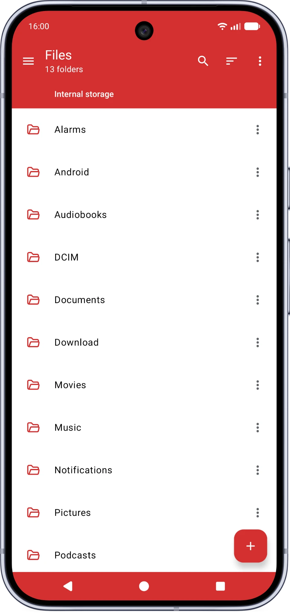
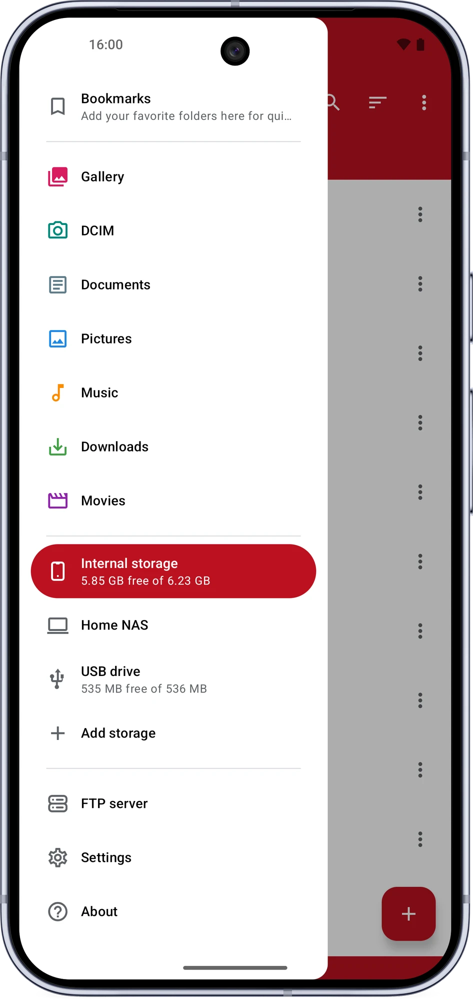
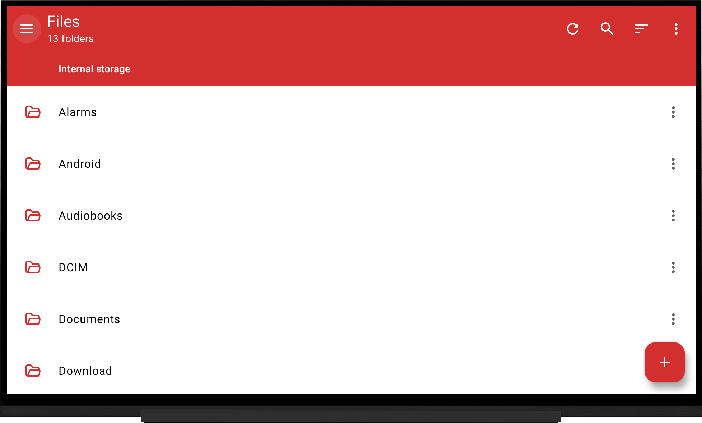

# VFiles

**English** · [Français](README.fr.md)

[](https://github.com/Victor-root/VFiles/releases)
[](https://github.com/Victor-root/VFiles/commits/main)
[](https://github.com/Victor-root/VFiles/releases/latest)
[](https://github.com/Victor-root/VFiles/releases/latest)

## 📸 Screenshots

<p align="center"><strong>📱 Mobile</strong></p>
<p align="center">
<picture>
  <source media="(prefers-color-scheme: dark)" srcset="docs/screenshots/mobile-dark.webp" />
  
</picture>
&nbsp;&nbsp;
<picture>
  <source media="(prefers-color-scheme: dark)" srcset="docs/screenshots/sidebar-dark.webp" />
  
</picture>
</p>

<p align="center"><strong>📺 Android TV</strong></p>
<p align="center">
<picture>
  <source media="(prefers-color-scheme: dark)" srcset="docs/screenshots/tv-dark.png" />
  
</picture>
</p>

## 📥 Download and updates

<p align="center">
  <a href="https://victor-root.github.io/Omnify/add?url=https%3A%2F%2Fgithub.com%2FVictor-root%2FVFiles"></a>&nbsp;&nbsp;&nbsp;&nbsp;&nbsp;<a href="https://github.com/Victor-root/VFiles/releases"></a>
</p>

## ✨ What this fork changes

### 🧩 Rebuilt in Jetpack Compose
- The whole interface is rebuilt in Jetpack Compose and Material 3: neutral backgrounds, a red accent by default, settings choices in bottom sheets and grouped action menus.
- Faster startup and smoother scrolling of large folders, with screens opening inside the app.
- Requires **Android 8.0 or newer**.

### 🖼️ Gallery, music, video and PDF built in
- **Gallery** in the sidebar: photos and videos by day or month, albums of folders, and a full screen viewer.
- **Music player**: songs, albums and artists, with background playback controlled from the notification. Add it to the sidebar from Settings → Standard folders.
- **Video player** and **PDF viewer** (page by page or fit to width, pinch to zoom, go to page).

### 🔑 Shizuku support
- With [Shizuku](https://shizuku.rikka.app/) (or Sui), Android/data and Android/obb can be browsed without root.
- One tap **"Grant with Shizuku"** gives the access to all files, even on TVs whose settings can't give it.

### 📺 Android TV support
- Full D-pad navigation: the sidebar, toolbar and file lists are reachable and highlight correctly with a remote.
- A refresh button in the header, the menu key opens menus, left opens the sidebar, and choice dialogs focus the current choice.

### 🚀 First-launch onboarding
- Asks up front for the permissions the app needs (all-files access, notifications, installing apps), laid out as tiles on TVs.
- Where only adb can give the access to all files, it shows the exact command, or the Shizuku button when Shizuku is running.

### 💾 Removable storage (SD card / USB)
- SD cards and USB drives **appear automatically in the sidebar** when plugged in, with no "Add storage" step.
- **Rename** a volume and choose its **icon**; USB or SD is detected automatically.
- The partitions of one drive are grouped under a single **"USB drive" / "SD card"** header.
- **Eject** shortcut, and the free space refreshes live.

### 🎯 Default apps and file operations
- **Settings → Default apps**: pick which app opens images, audio, video, PDF and text, VFiles' own viewers included.
- During copies, moves and archive operations, a toolbar button shows the live progress of each file.

### 🔒 Privacy & performance
- **Firebase (Analytics + Crashlytics) removed entirely.** Nothing about your usage or crashes leaves the device, and the app starts faster.
- Cloud backup and data extraction disabled.

### 🎨 Interface
- Status and navigation bar icons follow what is drawn behind them, the open drawer included.
- Dark app bar in night mode, icons in the ⋮ menus, and a Material You drawer.
- Long names wrap instead of being cut off; a ribbon marks bookmarked folders.
- Optional **edge-to-edge display** (Settings → Interface): content scrolls behind the system bars. Off by default.

### 🐛 Other fixes & polish
- A clear message when a folder can't be opened.
- Optional **encryption** for SMB shares, and a much faster scan for SMB servers on the local network.
- Reorder the standard folders of the sidebar, with a drag or the D-pad.
- Fixed a crash on tablets in landscape; Back at the root exits the app; long toolbar titles scroll.
- Fork strings translated into **31 languages**.
- App ID `fr.vroot.vfiles`, so it installs alongside the Play/F-Droid build of Material Files.

## ⬆️ Updating VFiles

- **Direct download**: install the latest APK from the [Releases page](https://github.com/Victor-root/VFiles/releases) over your current one. It's always signed with the same key, so your files and settings are kept.
- **[Omnify](https://github.com/Victor-root/Omnify)**: my F-Droid client fork that installs and updates apps straight from their GitHub repo.

The first time, the app opening the APK asks for permission to install unknown apps.

## 🗂️ Making VFiles the default system file picker

VFiles exposes **every backend it supports** through Android's file picker: local storage, SMB, FTP, SFTP and WebDAV shares, and the contents of archives all show up as folders in any app's "Open" or "Save" dialog.

Android sends `ACTION_OPEN_DOCUMENT`, `ACTION_CREATE_DOCUMENT`, `ACTION_OPEN_DOCUMENT_TREE` and `ACTION_GET_CONTENT` to **DocumentsUI** (`com.google.android.documentsui`, or `com.android.documentsui` on AOSP-based ROMs). Disabling it makes VFiles the picker for every app. No root needed.

### From the app, with Shizuku

With [Shizuku](https://shizuku.rikka.app/) running, turn on **VFiles as the default file picker** in the settings. VFiles explains what will happen first, and turning the option off restores the picker as it was. If the picker was removed with `pm uninstall --user 0`, the option shows as on, and turning it off brings the picker back.

**Turn the option off before uninstalling VFiles.** Android doesn't turn its picker back on by itself, so no app could pick files anymore. To repair that, reinstall VFiles and turn the option off, or run the commands below.

### From a computer, with ADB

```sh
# Make VFiles the default picker (the second line is for AOSP-based ROMs,
# the third for ROMs with an overlay module; ignore errors for missing ones)
adb shell pm disable-user --user 0 com.google.android.documentsui
adb shell pm disable-user --user 0 com.android.documentsui
adb shell pm disable-user --user 0 com.google.android.overlay.modules.documentsui

# Restore the system picker
adb shell pm enable com.google.android.documentsui
adb shell pm enable com.android.documentsui
adb shell pm enable com.google.android.overlay.modules.documentsui
```

### Notes

- The change survives reboots and only applies to the current user (usually user 0). Tested on **LineageOS** and other AOSP-based ROMs.
- `ACTION_GET_CONTENT` and `ACTION_PICK` also reach apps like Drive or a gallery, so Android shows a chooser: pick VFiles and **Always**. Android remembers it per file type, so it may ask again for another type.
- **Recent Android versions** (seen on Android 16): image and video requests through `ACTION_GET_CONTENT`, and all `ACTION_PICK_IMAGES` requests, get the system Photo Picker, which an app can't replace. Disabling `com.google.android.photopicker` brings back the older picker where it exists, whose **Browse** entry opens VFiles.
- **Android TV:** DocumentsUI isn't installed, and a stub that does nothing shows up in the chooser. Pick VFiles and **Always**, or disable it with `adb shell pm disable-user --user 0 com.android.tv.frameworkpackagestubs`.
- The other jobs of the system files app also go to VFiles: storage tiles in Settings, opening downloads, and folder access requests from apps made before Android 10.
- **Archives** open like folders to pick a file inside, unless the app asks for the archive itself. Files inside archives are read-only.
- **FTP and WebDAV** can only replace whole files, so apps writing part of a file get an error. SMB and SFTP don't have this limit.

### 🔧 For ROM builders

An opt-in `systemPicker` build variant, signed with the ROM's platform key, replaces DocumentsUI outright and returns the same storage URIs, so even apps that require them work. See [`docs/systempicker-integration.md`](docs/systempicker-integration.md). It doesn't affect a normal install.

---

## About the original app ℹ️

Material Files is an open-source Material Design file manager for Android 6.0+:

- Material Design with attention to detail, and breadcrumb navigation.
- Root support; view/extract/create common archives; FTP, SFTP, SMB and WebDAV.
- Customisable colours and night mode (with optional true black).
- Linux-aware (symbolic links, permissions and SELinux context) via real system calls rather than parsing `ls`, built on the Java NIO2 file API with `ViewModel`/`LiveData`.

## 💭 Why this fork?

Material Files is already an excellent app. This is **not** a competitor or a criticism of the original. I forked it to build a version tailored to **my own daily use**: mostly small UI-consistency improvements, bug fixes, and first-class **Android TV** support. Everything above sits on top of the original author's work, and all credit for the app itself goes to him.

## 🙏 Credits & license

- **Original app and all of its core features:** [Hai Zhang](https://github.com/zhanghai) and contributors.
- **This fork:** [Victor-root](https://github.com/Victor-root).

Released under the **GNU General Public License v3.0**, the same license as the original. See [LICENSE](LICENSE).

```
Copyright (C) 2018 Hai Zhang
Copyright (C) 2024 Victor-root (fork modifications)

This program is free software: you can redistribute it and/or modify it
under the terms of the GNU General Public License as published by the Free
Software Foundation, either version 3 of the License, or (at your option)
any later version. It is distributed WITHOUT ANY WARRANTY; see the GNU
General Public License for more details.
```
