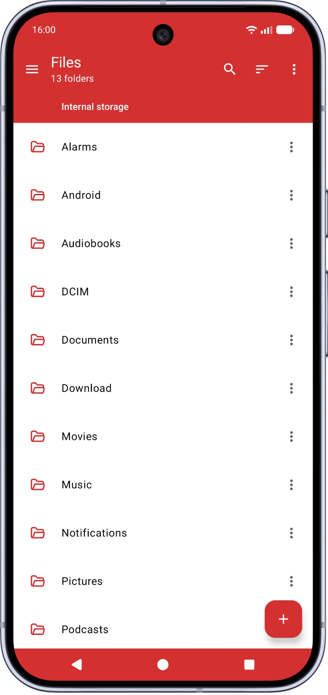
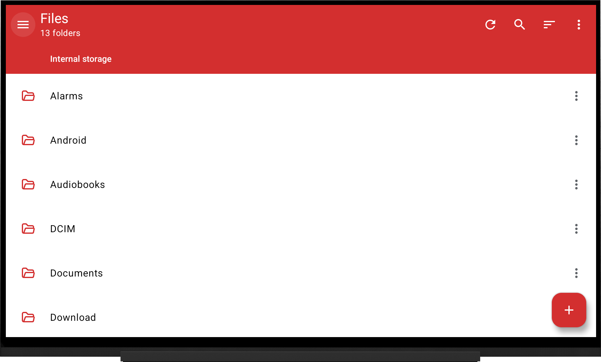

# VFiles

**English** · [Français](README.fr.md)

[](https://github.com/Victor-root/VFiles/releases)
[](https://github.com/Victor-root/VFiles/commits/main)
[](https://github.com/Victor-root/VFiles/releases/latest)
[](https://github.com/Victor-root/VFiles/releases/latest)

[](https://github.com/Victor-root/Omnify)

## 📸 Screenshots

<p align="center"><strong>📱 Mobile</strong></p>
<p align="center">
<picture>
  <source media="(prefers-color-scheme: dark)" srcset="docs/screenshots/mobile-dark.webp" />
  
</picture>
</p>

<p align="center"><strong>📺 Android TV</strong></p>
<p align="center">
<picture>
  <source media="(prefers-color-scheme: dark)" srcset="docs/screenshots/tv-dark.png" />
  
</picture>
</p>

## ✨ What this fork changes

### 🧩 Rebuilt in Jetpack Compose
- The whole interface is rebuilt in Jetpack Compose and Material 3: neutral backgrounds, a red accent by default, open folder icons, settings choices in bottom sheets and grouped action menus.
- Faster startup and smoother scrolling of large folders, with screens opening inside the app instead of separate windows.
- Requires **Android 8.0 or newer**.

### 🖼️ Gallery, music, video and PDF built in
- **Gallery** in the sidebar: photos and videos by day or by month, albums of folders, and a full screen viewer with zoomable photos and a video player.
- **Music player**: songs, albums and artists, playback in the background controlled from the notification.
- **Video player** and **PDF viewer** (one page at a time or fit to the width of the screen, pinch to zoom, go to page).

### 🔑 Shizuku support
- With [Shizuku](https://shizuku.rikka.app/) (or Sui), Android/data and Android/obb can be browsed without root.
- One tap **"Grant with Shizuku"** gives the access to all files, even on TVs whose settings can't give it.

### 📺 Android TV support
- Full D-pad navigation: the sidebar, toolbar and file lists are reachable and highlight correctly with a remote.
- A refresh button in the header, the menu key of remotes opens menus, D-pad left opens the sidebar, and choice dialogs focus the current choice.
- PDFs open fit to the width of the screen.

### 🚀 First-launch onboarding
- A welcome flow that requests the permissions the app needs (all-files access, notifications, installing apps) up front, laid out as tiles on TVs.
- Where only adb can give the access to all files, it shows the exact command to run, or the Shizuku button when Shizuku is running.

### 💾 Removable storage (SD card / USB), reworked
- SD cards and USB drives **appear automatically under "Internal storage"** and refresh when you plug one in. No manual "Add storage" SAF dance.
- **Rename** a volume and choose its **icon**; USB vs SD is auto-detected (with a manual override).
- A multi-partition drive is grouped under a single **"USB drive" / "SD card"** header, with its partitions nested as **"Partition 1, 2, …"**.
- **Eject** shortcut, and the free-space figure refreshes live (e.g. right after deleting files) instead of only after a restart.

### 🎯 Default apps per file type
- New **Settings → Default apps**: pick which app opens Images, Audio, Video, PDF and Text, VFiles' own viewers included, so those files open straight away in your app of choice. Without a choice, Android asks every time.

### 📋 File operation progress
- A progress button appears in the toolbar during copies, moves and archive operations, opening a popover with live per-file details instead of only a notification.

### 🔒 Privacy & performance
- **Firebase (Analytics + Crashlytics) removed entirely.** Nothing about your usage or crashes is sent anywhere, and the app also starts faster without it.
- Cloud backup and data extraction disabled, so Android never ships app data off-device.

### 🎨 UI consistency & theming
- Status-bar icons tint themselves to the header/drawer colour (light or dark), fixing unreadable white-on-white and black-on-dark cases, with a smooth crossfade when the drawer opens.
- Dark app bar in night mode instead of the light primary tint.
- Icons shown in the ⋮ overflow menus; themed popup in dark mode.
- Navigation drawer redesigned and themed for Material You (M3), including dark-mode colour and switch-thumb fixes.
- Long names wrap instead of being cut off with "…".
- Internal storage renamed with a phone icon; a real ribbon marks bookmarked folders; refreshed FTP-server icon.
- Optional **edge-to-edge display** (Settings → Interface → "Edge-to-edge display"): content scrolls behind the status and navigation bars instead of stopping above them. Off by default.

### 🐛 Other fixes & polish
- Friendly message when a folder can't be opened, instead of a silent failure.
- Optional per-server **encryption** for SMB shares, and a much faster scan for SMB servers on the local network.
- Reorder the standard folders of the sidebar, with a drag or a D-pad.
- Fixed a crash on tablets in landscape, and the status/navigation bars are now coloured to match the app bar.
- Back exits at the root instead of leaving the app stuck, and long toolbar titles now marquee-scroll.
- All fork-specific strings translated into **31 languages**.
- App ID changed to `fr.vroot.vfiles` so it installs alongside the Play/F-Droid build rather than conflicting with it.

## ⬆️ Updating VFiles

Two ways to get updates:

- **Direct download**: grab the latest APK from the [Releases page](https://github.com/Victor-root/VFiles/releases) and install it over your current install. Signed with the same key every time, so your files and settings are kept.
- **[Omnify](https://github.com/Victor-root/Omnify)**: my own F-Droid client fork that installs and tracks apps straight from their GitHub repo. Add this repo and it keeps VFiles up to date for you.

Either way, the app opening the file (browser, file manager, or Omnify) will ask, the first time, for permission to install unknown apps.

## 🗂️ Making VFiles the default system file picker

VFiles exposes **every backend it supports** through Android's file picker, not just local storage: SMB, FTP, SFTP and WebDAV shares, and the contents of archives, all show up as regular folders inside any app's "Open" or "Save" dialog, the same way a local folder would.

Android routes `ACTION_OPEN_DOCUMENT`, `ACTION_OPEN_DOCUMENT_TREE` and `ACTION_GET_CONTENT` intents through **Google DocumentsUI** (`com.google.android.documentsui`), even when VFiles is installed as a DocumentsProvider. Disabling that system app makes Android fall back to VFiles as the picker for every app on the device. No root required, just ADB over USB.

### Disable (make VFiles the default picker)

```sh
# Disable the main DocumentsUI app
adb shell pm disable-user --user 0 com.google.android.documentsui

# Disable its overlay module (present on some ROMs; ignore the error if absent)
adb shell pm disable-user --user 0 com.google.android.overlay.modules.documentsui
```

After running these, any app that opens a file or folder picker will use VFiles instead.

### Re-enable (restore Google's picker)

```sh
adb shell pm enable com.google.android.documentsui
adb shell pm enable com.google.android.overlay.modules.documentsui
```

### Notes

- **No root needed**: `pm disable-user --user 0` runs over a standard ADB (USB debugging) connection.
- Tested on **LineageOS** and other AOSP-based ROMs. On stock OEM ROMs the overlay package name may differ or be absent; the `pm disable-user` command for the main package is sufficient in that case.
- The change survives reboots but is **per-user** (only affects the user whose session is active when ADB runs, typically user 0).
- If another picker app is installed (e.g. a third-party file manager with a DocumentsProvider), Android may show a chooser. Install only one provider if you want zero prompts.

### 🔧 For ROM builders: making it the literal system picker

A separate, opt-in `systemPicker` build variant lets a ROM builder replace DocumentsUI outright: signed with the ROM's platform key, VFiles hands back the exact same storage URIs DocumentsUI would, so even apps that specifically require them (not just apps using the generic picker above) work against it. See [`docs/systempicker-integration.md`](docs/systempicker-integration.md) for the requirements and integration steps. This does not affect a normal install in any way.

---

## About the original app ℹ️

Material Files is an open-source Material Design file manager for Android 6.0+:

- Material Design with attention to detail, and breadcrumb navigation.
- Root support; view/extract/create common archives; FTP, SFTP, SMB and WebDAV.
- Customisable colours and night mode (with optional true black).
- Linux-aware (symbolic links, permissions and SELinux context) via real system calls rather than parsing `ls`, built on the Java NIO2 file API with `ViewModel`/`LiveData`.

## 💭 Why this fork?

Material Files is already an excellent app. This is **not** a competitor or a criticism of the original. I forked it to build a version tailored to **my own daily use**: mostly small UI-consistency improvements, bug fixes, and first-class **Android TV** support. Everything above sits on top of the original author's work, and all credit for the app itself goes to him.

## 🙏 Credits & license

- **Original app and all of its core features:** [Hai Zhang](https://github.com/zhanghai) and contributors.
- **This fork:** [Victor-root](https://github.com/Victor-root).

Released under the **GNU General Public License v3.0**, the same license as the original. See [LICENSE](LICENSE).

```
Copyright (C) 2018 Hai Zhang
Copyright (C) 2024 Victor-root (fork modifications)

This program is free software: you can redistribute it and/or modify it
under the terms of the GNU General Public License as published by the Free
Software Foundation, either version 3 of the License, or (at your option)
any later version. It is distributed WITHOUT ANY WARRANTY; see the GNU
General Public License for more details.
```
